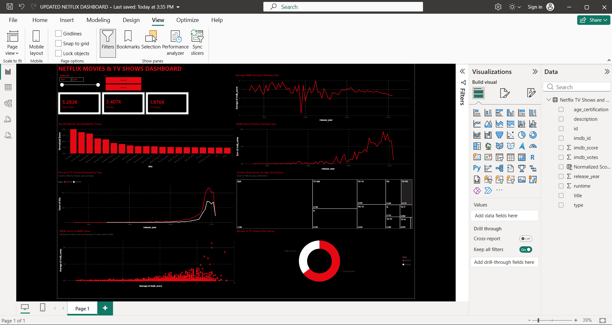

# Netflix Movies & TV Shows Dashboard (Power BI)

Interactive Power BI dashboard analyzing 5,283 Netflix titles
(3,407 movies and 1,876 TV shows, released 1953-2022).

## Tools Used
- Power BI Desktop

## Dashboard Features
- KPI cards: total titles, movies, TV shows
- Slicers: release year range and content type
- Average IMDb rating by release year
- Total IMDb votes by release year
- Movies and TV shows released per year
- Top 20 titles by Normalized Score
- IMDb score vs votes scatter plot
- Age certification mix (treemap)
- Movies vs TV shows split (donut chart)

## Key Insights
- Movies make up 64.5% of titles and TV shows 35.5%.
- Releases peaked around 2018-2019.
- Average IMDb rating fell from about 7 before 2000 to about 5.8 by 2022.
- TV-MA is the largest rated certification group (790 titles);
  about 43% of titles have no certification recorded.
- Inception, Forrest Gump and Breaking Bad lead the Normalized Score ranking.

## Files
- Netflix_Dashboard.pbix: the Power BI dashboard
- Netflix TV Shows and Movies.xlsx: the dataset
- dashboard_screenshot.png: dashboard preview

## How to Open
Download the .pbix file and open it in Power BI Desktop (free for Windows).
